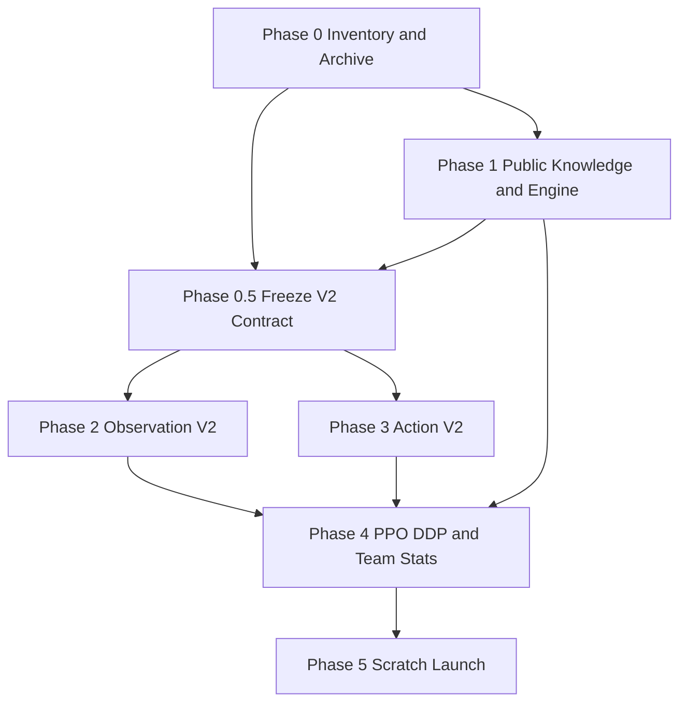

# Phased engineering execution plan

## Execution model

Operate in six phases. Keep one canonical integration branch and short task branches if parallel work is necessary. Each phase produces: code changes; unit/regression tests; an immutable evidence manifest (source SHA, command line, data SHA, environment, pass/fail, artifacts); a commit; a handoff. No phase may claim success from an unsupported textual assertion.

**Do not parallel-edit shared contracts:** `engine/src/observation.rs`, `agent/types/observation.py`, `agent/train/native_collector.py`, `agent/model/scorer.py` and the checkpoint code require an explicit integrator. Parallel engine, policy and stats development is allowed only after agreed V2 interface files are frozen.

### Dependency graph

## Phase 0: source of truth and preservation

- Identify Git working trees, HEADs, detached branches and uncommitted diffs, active process command lines and process-owned working directories.
- Reconcile recovered MiniDC commits (`266bb65`, `3df5abd`) with audited remote branch head `d10ac692`; inspect actual binary/build provenance, not just `.py` files.
- Archive original ~1.33M PPO logs, model, Adam, GradScaler, scheduler/RNG, manifests, team corpus, production telemetry and independent Evaluation League run metadata **without mutation**. Hash receipts and set archived dataset/read-only protection where supported.
- Coordinate graceful stop for original PPO ONLY if still active, by original launcher or signal that allows synchronized checkpoint; preserve Evaluation League unless user explicitly changes this.
- Resolve actual 1,220-team **loader bytes**, `team_count=1220`, order and manifest SHA across both ranks. A9.4 config currently points to 1,137. Don't assume the local run was wrong merely because the old default exists.
- Establish a new branch, new run root and a work log. No training yet.

**Gate P0:** source + dataset receipt; old-run preservation verified; precisely identified old services; risk matrix updated with any local-only code changes.

## Phase 1: semantic engine and public-information correctness

- Establish separate representations for raw World, server-internal request, player-visible request and player-safe Knowledge.
- Implement source-specific tests of `set_type` paths: Soak, Magic Powder, Double Shock, Burn Up, Protean, Libero, plus already working Mega, forme and Mimicry.
- Verify switch-out reversion, Transform, Illusion, type-changing effects and permission-specific knowledge; never overwrite public belief with private World information.
- Create hidden-information paired-state noninterference tests, especially Imprison `disabled` / `hidden` flags and inactive Pokémon.
- Reproduce or disprove stale benched `MoveDisabled` effect. Preserve legitimate carry-over effects.
- Verify duration lifecycles of Trick Room, weather, terrain, Tailwind and screens but do not rewrite working implementations.
- Enumerate all mechanics reachable by 1,220 sets plus dynamically invoked effects; compare representative difficult scenarios against pinned Showdown fixtures; distinguish unsupported/unverified features from supported.

**Gate P1:** public-only state tests pass; no known hidden leak; no unsupported *reachable* effect silently treated as correct; test evidence identifies every disproven earlier concern.

## Phase 0.5: freeze Observation/Action V2 contracts

In parallel with Phase 1 only when needed, draft the V2 interface from documents 04 and 05. Finalize after effects and public-information semantics are understood. Record schema IDs, exact layouts, ragged offsets/masks, signed targets, roster identity, precision units, serialization and version hashes. Never implement independent encoders against an unstable draft contract.

## Phase 2: Observation V2 and precision

- Build a field-by-field producer/consumer ledger covering fixed 96 tokens, ragged arrays, presence and explicit known masks.
- Ensure all five ragged families reach the neural network; prefer masked, bounded ragged embeddings/pooling. Exhaustive overflow coverage; **no unreported truncation**. If requiring a structured bound, prove maximum or dynamic support. Keep public knowledge vs private World semantics intact.
- Represent numeric/boolean `known` explicitly, and validate ID vocab; replace silent clamp with a justified unknown/padding policy and fail-fast on invalid known IDs.
- Audit all 50 float slots against real min/max and Mode D FP16; choose scales preserving meaningful signed values and appropriate normalization for weight, duration, HP, move stats, etc. Do not change battle physics.
- Update packed wires, typed adapter, inference batching, RolloutBuffer columnar storage, evaluator, checkpoint model construction and metadata.
- Negative tests for schema mismatch, corrupted sections, ragged count mismatch, NaN, false knowns and hidden values.

**Gate P2:** native→wire→actor→buffer→learner→model parity, 5 ragged groups truly consumed; controlled changes in public effects and history alter model-visible representations; invisible private changes do not.

## Phase 3: Action V2

- Establish canonical action wire schema; explicitly decode target signed i8 `[-2,-1,0,1,2]`; 255 `NO_SLOT` is a **different field semantic** from target -1.
- Implement per-observation active position→roster identity resolution using `view.own.active` or explicitly encoded equivalent. Apply to MOVE, SWITCH, PASS, PICK and forced replacement; avoid errors after substitutions and fainting.
- Ensure same token and canonical action ID semantics in Typed, Packed, Batched Evaluator, RolloutBuffer and PPO recomputation.
- Add switch destination token/target token as architecture improvements if needed, without conflating with mandatory actor-index correctness.
- Validate candidate capacity: no silent truncation, exact conditional prefix validity, Mega resource shared constraints, double swaps, forced replacements, Struggle, locked moves, unchoosable actions and waits.

**Gate P3:** canonical candidate set equality, per-candidate token references equality, logits parity to stated tolerance and every legal target distinct. Rolling slot bug fixed if feature supported; otherwise locked off.

## Phase 4: end-to-end learner, statistics and independent eval

- Reconfirm reward assignment (+1/-1/draw 0), GAE keyed by `(match_id, side)`, singleton requests excluded from Actor gradients, bootstrap/truncation semantics, advantage normalization, PPO ratio and gradient coefficients.
- Differentially test DDP 2-rank vs single-process reference, AMP recompute, optimizer moments, checkpoint replay and source SHA guards.
- Implement stats exactly as document 07. Capture events on **natural** match termination, not on request or rank counters alone. Distinguish tentative and committed iterations; two appearances per match, one completed match. Rank results + global reconciliation and atomic commit with checkpoint generation.
- New evaluator explicitly rejects old V1 policy inputs; create separate league namespace. Add an independent unseen-team panel as a separate non-blocking evaluation enhancement if accessible; never mix team pools into training accidentally.
- Measure telemetry, team stats and ragged attention overhead on 2x V100; optimize only after correctness passes.

**Gate P4:** all release-blocking `09_TEST_MATRIX.csv` tests pass with evidence; two-V100 smoke runs real NativeEngine updates, both ranks digest match, no illegal actions or skipped optimizer steps; stats rollback/replay idempotence proven.

## Phase 5: new clean PPO campaign

- Freeze full source SHA, Dataset Manifest SHA, model architecture, precision, action and observation schemas, engine digest and run ID.
- Start new `PA3-V2` run with **new random initialized weights and fresh Adam/GradScaler/RNG/scheduler state**. No V1 checkpoint import (not even partial transfer).
- Use 1,220 frozen teams and validated baseline PPO-2 settings unless correctness requires change. If deviations required, document reasons and revalidate all gates.
- Commit at verified iteration/checkpoint boundaries. Begin stats from first newly committed natural match.
- Create separate V2 Evaluation League; old run remains immutable historical evidence. Model/optimizer/telemetry and per-team stats commit receipts must agree.
- Provide launch receipt and real production observations including exact matches, real games/s, losses, KL, entropy, rank digests, stats counters, and next checkpoint schedule.

**Gate P5:** run at >0 committed matches with verified updates, per-rank telemetry, resume path and stat integrity. A short smoke does not establish long-term training stability.

## Anti-patterns prohibited

- Changing `target_approx_kl` or recompute tolerance to hide invalid data.
- Silently using stale observed World fields, opponent hidden information or future event data.
- Treating all available Rust ragged sections as automatically public.
- Passing shape-only tests while semantics remain broken.
- Treating team wins as independent team quality (same policy, unbalanced opponents).
- Overwriting old data or continuing old optimizer/weights in new run.
- Changing 1,220 team sets to make engine pass.
- Claiming complete Regulation M-C support from natural terminations alone.
- Automatically rewriting verified duration code without an actual failing test.

## Minimal phase handoff

Each phase report includes SHA/branch, updated issue IDs, command/test output with environment, changed files, fail/pass/blockers, reproducibility artifacts, last safe restore point, next actions and any performance deltas relative to controlled baseline.
